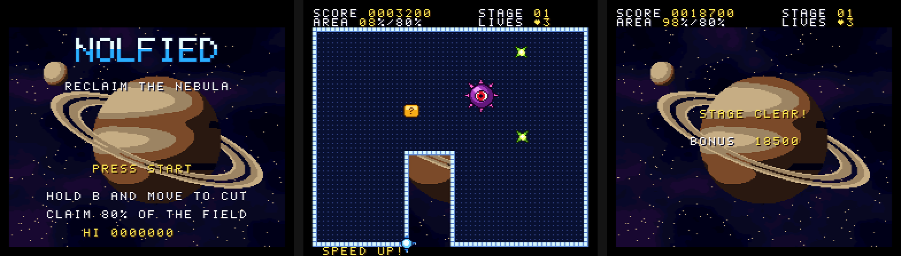

# NOLFIED

A territory-claiming arcade game for the **Super Nintendo / Super Famicom**, in the
spirit of the old Qix / Volfied games. Cut lines through a force field to claim
territory and uncover the hidden picture underneath. Claim **80%** of the field to
clear the stage, and don't let anything touch your line while you're cutting.



## Play it

The ready-to-run ROM is **[`dist/nolfied.sfc`](dist/nolfied.sfc)** (256KB LoROM, NTSC).

- **MAME:** `mame snes -cart dist/nolfied.sfc`. MAME needs its own `snes` BIOS set
  (the file `spc700.rom` in `snes.zip`) in your rompath, same as for any SNES game.
- **bsnes / higan / ares, Snes9x, Mesen, RetroArch:** open `nolfied.sfc` directly.
- It should also run from an SD-card flash cart on real hardware. It doesn't use any
  special chips or save RAM.

## Controls

| Button | Action |
| --- | --- |
| D-pad | Move along the edge of your claimed area |
| Hold **B** (or A / X / Y) + D-pad | Leave the edge and cut a line into open space |
| Let go of B while cutting | Your ship pulls back along the line to where it started |
| Start | Start the game / pause |
| Left / Right, B, Select (draft) | Pick a card, take it, reroll once |

## Rules

- When your line reaches an edge again, the area on the side **without the big
  eye-boss** is claimed and that part of the picture appears.
- If the boss or a star-shard touches your line, or touches you while you're cutting,
  you lose a life.
- Star-shards caught inside a claimed area are destroyed.
- **?** capsules you enclose give a random power-up: speed up, a 10s shield, freezing
  the enemies, or an extra life.
- There are four hidden pictures that repeat, and each stage adds speed and shards.

## Chips x Mult, chains and perks

Scoring works like Balatro:

- Every claim scores **chips x mult**. Chips are the number of cells you claimed. You
  see the sum pop up under the field, e.g. `220 X 12 = +26400`, and the screen
  shakes and flashes harder for bigger claims and bigger multipliers.
- **Chain:** each claim adds one link, and each link adds +1 mult. You lose the chain if
  you die, or if 10 seconds pass without a claim (the orange bar on the HUD).
- **Perk draft:** before every stage you pick **1 of 3 perk cards**. Perks stack, and
  you can reroll the offer once per draft with SELECT. Rarity sets the frame colour:
  common is blue, special is green and rare is pink. Your perks show along the top row.

| Perk | Rarity | Effect |
| --- | --- | --- |
| GREED | common | +2 mult on every claim |
| CHAIN | common | every chain link is worth +1 more mult |
| TITAN | special | x2 mult on claims of 150+ cells (x3, x4 when stacked) |
| SNIPER | common | +6 mult on claims under 40 cells |
| HUNTER | common | +3 mult per shard killed this stage |
| SWIFT | common | move faster |
| AEGIS | special | absorbs one hit per stage |
| STASIS | common | each claim freezes the enemies for 1.5s |
| CHRONO | special | enemies 20% slower |
| PHOENIX | special | +1 life |
| LUCKY | common | +1 capsule each stage |
| PRISM | rare | +1 mult for each perk you own |
| GLASS | rare | x3 mult, but costs a life |
| QUOTA | special | stage goal -5% |
| JACKPOT | common | each capsule gives +4 mult for the rest of the stage |
| MIDAS | special | x2 stage-clear bonus |

Some combinations work well together: SNIPER + CHAIN for lots of quick small claims,
TITAN + GLASS for a few huge cuts, or PRISM once you have a lot of perks.

## Building

Needs `cc65` (for `ca65`/`ld65`), Python 3, Pillow and numpy.

```sh
sudo apt install cc65
pip install pillow numpy
make            # -> build/nolfied.sfc
```

- `tools/gen_assets.py`: generates all the graphics: the field tiles, font, logo,
  sprites, and the four stage pictures, which are drawn in code.
- `tools/gen_icons.py`: the 32x32 perk card icons and the 8x8 HUD versions.
- `src/main.s`: the whole game in 65816 assembly, with a tiny SPC700 sound driver
  embedded as bytes.
- `tools/retro.py` / `tools/playtest.py`: a headless libretro host (uses the
  bsnes-mercury core: `apt install libretro-bsnes-mercury-accuracy`) for scripted and
  random-input soak tests. The soak test also checks the field's internal state.

## Tech notes

- Mode 1. BG2 holds the stage picture and BG1 is the force field on top of it. Each
  BG1 tile is a 2x2 block of 4x4-pixel cells. Every combination of the four cell
  states (open / claimed / edge / line) has its own tile, which gives 256 tiles, so the
  field has a 60x48 grid while the map is still made of ordinary tiles.
- Claiming uses a flood fill from the boss's position. Anything it doesn't reach gets
  claimed, then the edge cells are worked out again.
- Sound: a 30-byte SPC700 program that writes DSP registers on request. The 65816
  side sequences the sound effects, the jingles and a looping bass line.
